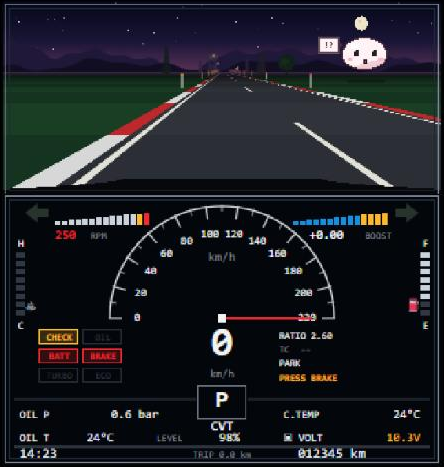

# Tiny Turbo

**Play:** https://thikander.github.io/tiny-turbo/

A low-res instrument cluster for a small turbo car with a CVT, running in one HTML file. It comes in two looks: a glowing digital cluster (the default) and a 90s-style analog one with a red brushed plate, white dials, red needles and a drum odometer; switch with **ANALOG/DIGI** in settings. The car is simulated, the engine sound is synthesized live in the browser, and there is a 3D road view and a small mochi travel buddy that reacts to how you drive and to the trip.

## Controls

| Key | Action |
| --- | --- |
| `I` | Start / stop the engine (gear must be in P or N) |
| `↑` | Throttle. Hold `Shift` for part throttle |
| `↓` | Brake |
| `Space` | Handbrake |
| `P` `R` `N` `D` `S` `L` | Gear selector. Leaving P needs the brake held |
| `+` / `-` | Manual steps (M1 to M7) in D or S |
| `←` / `→` | Turn signal. Above 25 km/h it also changes lane |
| `T` | Trip computer page: trip, average km/L, range, instant km/L, outside temperature |
| `Esc` | Pause |

On phones and tablets a handheld-style touch pad appears instead (toggle it with **PAD** in settings):

| Button | Action |
| --- | --- |
| `START` | Start / stop the engine |
| `A` / `B` | Gas / brake (hold) |
| `P` `R` `N` `D` `S` `L` | Gear selector. Hold `B` to leave P |
| `▲` / `▼` | Manual steps |
| `◀` / `▶` | Turn signal / lane change |
| `HAND BRAKE` | Toggle handbrake |
| `PAUSE` | Pause |

Tap the cluster to change the trip computer page. Everything else lives behind the gear button in the top-right corner. A short how-to dialog shows on the first visit; **HELP** brings it back. Thai is the default for every menu, the pad, the dialog and mochi; **TH/EN** switches language and the choice is remembered. The cluster itself always stays in English, like a real car.

**The game:** traffic shows up ahead as dark shapes with tail lights you can spot from far away. Change lane with `←` / `→` (or `◀` / `▶` on the pad) to get past. Hit a car and the run ends on a screen showing how far you drove; press any key or tap to go again. Traffic is light, a few cars at a time; switch it off with **TRAFFIC** in settings for a plain night drive.

Sound starts on the first key press or click. Use headphones or decent speakers; most of the engine note is low frequency.

To drive off: press `I`, wait for idle, hold `↓` and press `D`, then hold `↑`.

## The road

- The view is from the driver's seat, looking over the hood.
- A segment-based 3D road with real curves and hills: crests hide what is behind them, and uphill or downhill grades slow or push the car.
- Scenery changes at random every 1 to 3 km between fields, mountain forest with tunnels, city, coast, Thai rice paddies and highway, crossfading between them.
- A day clock starts at your local time and runs one game minute per second, with sunrise, sunset, stars, moon and clouds. Rain and thunderstorms come and go and leave the road wet.
- Light comes from the sky, your headlights, street lamps and tunnel lamps. Cars, buildings and tunnels are drawn as 3D boxes.
- Speed blur: above about 50 km/h the edges of the view smear toward the vanishing point, with streaks and a slight vignette that grow with speed.

## What is simulated

- **Engine:** 1.3 L turbo four-cylinder with a torque curve, friction and pumping losses, idle control with cold fast idle, a rev limiter at 6,500 rpm, and fuel cut on overrun.
- **Turbo:** spool depends on exhaust flow, so boost comes in with lag. A sharp lift with boost in the manifold opens the blow-off valve.
- **Transmission:** torque converter that slips at low speed and locks up above about 18 km/h, feeding a belt CVT.
  - `D`: continuous ratio, changing to stepped "D-step" shifts under heavy throttle.
  - `S`: 7-step sport mode.
  - `+` / `-`: manual mode.
  - `L`: holds a low ratio for engine braking.
- **Vehicle:** mass, rolling resistance, aero drag, brakes, and creep in gear.
- **Cluster:** spring-damped needles, a speedo that over-reads by about 2% like a real one, a bulb check at key-on, a buffered temperature gauge, a damped fuel gauge with a low-fuel lamp, a blue cold-engine lamp, a trip computer and a rolling drum odometer. The odometer, trip, fuel and oil level are saved between visits.
- **Gauges:** coolant and oil temperatures warm up over time. Oil pressure follows rpm and oil temperature. Fuel use is based on engine power. Battery voltage drops while cranking.

## Sound

There are no audio samples; everything is generated in an AudioWorklet:

- **Engine:** a sporty turbo four with a straight-through sport exhaust. Firing pulses come through unequal header runners, then header, mid-pipe and tail-pipe resonances, a bright muffler and a cabin drone. Pulse turbulence adds the rasp, the intake hardens past about 5,200 rpm, and idle has a slight lope that is rougher when cold.
- **Start sequence:** key-on relay click and fuel pump prime, the starter solenoid, ring-gear whine loaded by each compression stroke, coughs as it catches, the starter pinion spinning out, then the flare.
- **Turbo:** whistle, compressor whoosh, wastegate chatter at full boost, and a blow-off valve with a short flutter. Lifting off from high rpm gives overrun crackle with a flame from the exhaust (more in S and manual).
- **Car:** brake pad hiss and an occasional squeal at low speed, a body settle when you stop, the handbrake ratchet, gear lever detents through the gate, the turn-signal relay tick and tock, a reverse buzzer, CVT whine, and tyre, wind and road-joint thumps.
- **World:** rain on the roof, thunder, echo in tunnels and a short cabin reverb.

## Run locally

Open `index.html` in a browser. No build step, no dependencies.
